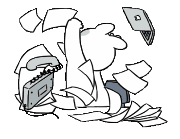

## ***hi, i'm arie***
i'm an aspiring EECS student... my friends and i build projects for local hackathons + community service

#### 💬 Languages & Technologies
` Python ` ` JavaScript ` ` ReactJS ` ` Java ` ` C++ ` ` HTML ` ` CSS ` `Swift`


 ### ~~~~~~~~~~~~~~~ Routine ~~~~~~~~~~~

<!--START_SECTION:waka-->


```text
Morning                  472 commits         ████████████░░░░░░░░░░░░░ 46.37 % 
Daytime                  209 commits         █████░░░░░░░░░░░░░░░░░░░░ 20.53 % 
Evening                  104 commits         ███░░░░░░░░░░░░░░░░░░░░░░ 10.22 % 
Night                    233 commits         ██████░░░░░░░░░░░░░░░░░░░ 22.89 % 
```
```text
Monday                   117 commits         ███░░░░░░░░░░░░░░░░░░░░░░ 11.49 % 
Tuesday                  123 commits         ███░░░░░░░░░░░░░░░░░░░░░░ 12.08 % 
Wednesday                138 commits         ███░░░░░░░░░░░░░░░░░░░░░░ 13.56 % 
Thursday                 184 commits         █████░░░░░░░░░░░░░░░░░░░░ 18.07 % 
Friday                   170 commits         ████░░░░░░░░░░░░░░░░░░░░░ 16.70 % 
Saturday                 199 commits         █████░░░░░░░░░░░░░░░░░░░░ 19.55 % 
Sunday                   87 commits          ██░░░░░░░░░░░░░░░░░░░░░░░ 08.55 % 
```


 Last Updated on 25/10/2026 21:04:06 UTC
<!--END_SECTION:waka-->

<div align="center">
  
</div>
